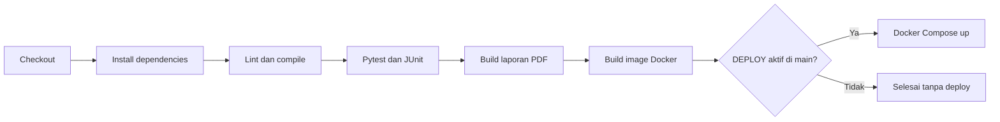

# KerjaYuk

Portal lowongan magang dan kerja paruh waktu untuk Tugas Besar 1 Komputasi Awan (DevOps & CI/CD Pipeline Jenkins), studi kasus K09. Proyek ini berisi frontend web, REST API, PostgreSQL, Docker Compose, pengujian otomatis, dan Jenkins pipeline.

Laporan proyek siap dibaca di [docs/laporan.pdf](docs/laporan.pdf), dengan sumber Markdown di [docs/laporan.md](docs/laporan.md).

## Fitur

- Jelajahi lowongan aktif dan cari berdasarkan judul/deskripsi, lokasi, dan tipe kerja.
- Kirim lamaran dengan CV PDF maksimal 2 MB.
- Terbitkan lowongan lewat formulir perusahaan pada halaman web.
- CRUD perusahaan dan lowongan melalui REST API.
- Alur status lamaran: `DIKIRIM` -> `DITINJAU` -> `DITERIMA` atau `DITOLAK`.
- Validasi lowongan kedaluwarsa, lamaran duplikat, tipe/ukuran CV, dan koneksi database.
- Alembic membuat versi skema database dan menerapkan migrasi saat API mulai.
- Jenkins menjalankan lint, tes, build image, dan deploy Compose opsional.

## Menjalankan dengan Docker Compose

Persyaratan: Docker Desktop atau Docker Engine dengan Docker Compose v2.

1. Salin `.env.example` menjadi `.env`. Ganti `POSTGRES_PASSWORD` sebelum deployment; URL koneksi API dibentuk otomatis dari nilai tersebut.
2. Jalankan aplikasi:

   ```sh
   docker compose up --build -d
   ```

3. Isi lowongan contoh (opsional):

   ```sh
   docker compose exec api python -m app.seed
   ```

4. Buka portal di <http://localhost:8000>, health check di <http://localhost:8000/health>, dan dokumentasi API di <http://localhost:8000/docs>.

Untuk menghentikan service tanpa menghapus data, jalankan `docker compose down`. Data PostgreSQL dan CV tetap berada di named volume. Untuk menghapus seluruh data lokal, jalankan `docker compose down -v`.

Service `api` menunggu health check PostgreSQL sebelum mulai. Image Nginx membawa frontend dan konfigurasi reverse proxy sendiri, meneruskan `/api/*` ke FastAPI, serta meneruskan `/health` dan dokumentasi API ke backend. Deploy tetap berjalan saat workspace Jenkins dibersihkan.

## Menjalankan tes

Gunakan Python 3.12 atau lebih baru:

```sh
python -m venv .venv
# macOS/Linux
. .venv/bin/activate
# Windows PowerShell: .venv\Scripts\Activate.ps1
python -m pip install -r requirements-dev.txt
python -m ruff check app tests
python -m pytest -q
python tools/build_report.py
```

Perintah terakhir membangun `docs/laporan.pdf` dari `docs/laporan.md`.

Tes memakai SQLite sementara dan tidak memerlukan PostgreSQL atau Docker. Database serta berkas CV dibuat ulang dalam fixture tes.

## REST API

Semua endpoint API berada di prefix `/api/v1`, kecuali health check.

| Method | Endpoint | Kegunaan |
| --- | --- | --- |
| `GET` | `/health` | Status API dan database |
| `GET`, `POST` | `/api/v1/companies` | Daftar atau buat perusahaan |
| `GET`, `PATCH`, `DELETE` | `/api/v1/companies/{company_id}` | Baca, ubah, atau hapus perusahaan |
| `GET`, `POST` | `/api/v1/jobs` | Cari/daftar dan buat lowongan |
| `GET`, `PATCH`, `DELETE` | `/api/v1/jobs/{job_id}` | Baca, ubah, atau hapus lowongan |
| `POST` | `/api/v1/jobs/{job_id}/applications` | Kirim lamaran multipart (`name`, `email`, `cv`) |
| `GET` | `/api/v1/jobs/{job_id}/applications` | Daftar lamaran untuk lowongan |
| `PATCH` | `/api/v1/applications/{application_id}/status` | Ubah status lamaran |

Pencarian lowongan menerima `q`, `location`, `employment_type`, dan `include_expired`. Nilai tipe kerja: `MAGANG`, `PARUH_WAKTU`, `PENUH_WAKTU`. Lihat skema penuh di `/docs`.

## CI/CD Jenkins dan GitHub Webhook

`Jenkinsfile` berisi tahap lint, tes, pembuatan laporan, build image, serta deploy Compose opt-in. Lihat [panduan Jenkins dan Webhook](docs/cicd.md) untuk konfigurasi Multibranch, GitHub, Ngrok, credentials, dan deploy demo.

Lihat juga [pembagian kontribusi](docs/pembagian-kontribusi.md) untuk alur branch, pull request, dan identitas kontributor GitHub.



## Struktur proyek

```text
app/                 FastAPI, skema, model, endpoint, seed demo
web/                 Frontend responsif HTML/CSS/JavaScript
nginx/               Image Nginx, frontend statis, dan reverse proxy API
tests/               Tes API dan aturan bisnis
docs/architecture.md Topologi, model data, endpoint
docs/cicd.md          Panduan Jenkins dan GitHub Webhook
docs/pembagian-kontribusi.md Jobdesk, branch, dan pull request tim
jenkins/              Image Jenkins dan bootstrap Multibranch Pipeline
docs/laporan.md      Sumber laporan proyek
docs/laporan.pdf     Laporan PDF siap dibagikan
alembic.ini          Konfigurasi migrasi skema database
migrations/          Riwayat skema Alembic
Jenkinsfile          Pipeline CI/CD
compose.yaml         API, PostgreSQL, dan Nginx
KerjaYuk.figcraft    Rancangan antarmuka desktop FigCraft
```

## Batasan MVP dan keamanan

Aplikasi belum memiliki autentikasi dan otorisasi. Endpoint pengelolaan perusahaan, lowongan, dan status lamaran terbuka; formulir “Pasang Lowongan” juga merupakan alur demo tanpa login. Jangan expose aplikasi ini sebagai layanan publik atau menyimpan data kandidat nyata sebelum autentikasi peran perusahaan ditambahkan. CV tersimpan sebagai file bernama acak di volume Docker; alur MVP belum menyediakan endpoint unduh CV.

## Tim

| Nama | NIM | Peran | Tanggung jawab |
| --- | --- | --- | --- |
| Muhammad Brilliant Agung Wicaksono | 102062400126 | Tech Lead / Backend | Struktur project, endpoint, aturan bisnis, migrasi, seeder, dan fitur inti; bukti PR backend yang di-merge |
| Ahmad Nurtajalla Garda Islam | 102062400012 | DevOps Engineer | Jenkins, webhook/Ngrok, credentials, dan Jenkinsfile; bukti konfigurasi job, Stage View, dan console log |
| Muhammad Naufal Syamdany | 102062400100 | Container Engineer | Dockerfile multi-stage, Compose, `.env.example`, dan health check; bukti config dan `docker compose ps` |
| Pasya Ayu Rastiti | 102062400004 | QA Engineer & Tech Writer | Unit/feature test, skenario pipeline gagal lalu pulih, README, diagram pipeline, dan laporan PDF; bukti test dan build merah lalu hijau |
