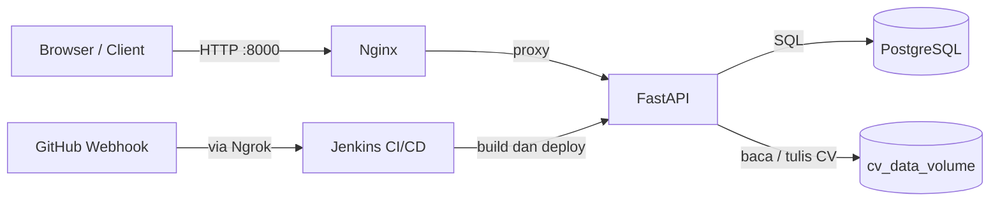
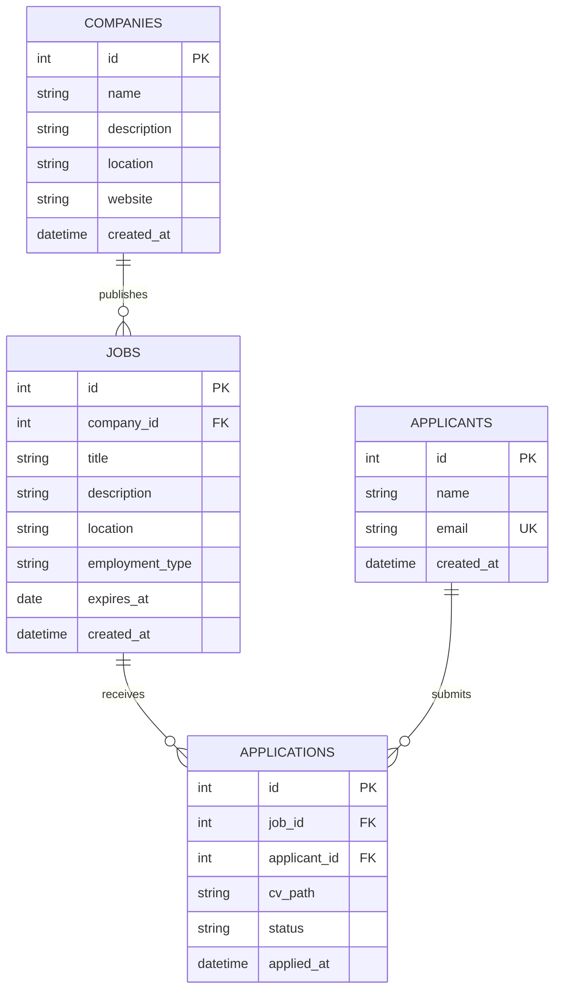

# Rancangan awal KerjaYuk

Dokumen ini menetapkan rancangan MVP agar implementasi backend, container, dan pengujian dapat berjalan dengan acuan yang sama. Pilihan stack dapat ditinjau kembali oleh tim sebelum implementasi dimulai.

## Stack dan topologi

- **FastAPI + Python 3.12** untuk REST API; dokumentasi OpenAPI tersedia dari FastAPI.
- **PostgreSQL** untuk data perusahaan, lowongan, pelamar, dan lamaran.
- **Nginx** menerima trafik pada port host `8000` dan meneruskannya ke API.
- **Docker Compose** menjalankan tiga service aplikasi: `nginx`, `api`, dan `db`.
- **Jenkins** menjalankan pipeline CI/CD secara terpisah dari tiga service aplikasi. GitHub Webhook melalui Ngrok memicu pipeline.
- Named volume `cv_data_volume` dipasang ke API untuk menyimpan file CV. Database menyimpan path file, bukan isi file.



## Model data MVP



Ketentuan skema:

- `applications` memiliki unique constraint `(job_id, applicant_id)` untuk mencegah lamaran ganda.
- `status` dibatasi ke `DIKIRIM`, `DITINJAU`, `DITERIMA`, atau `DITOLAK`.
- `employment_type` menggunakan nilai tetap yang disepakati API (MVP: `MAGANG`, `PARUH_WAKTU`, `PENUH_WAKTU`).
- Lowongan dianggap terbuka jika `expires_at` belum terlewati. Tidak perlu job terjadwal untuk menutupnya: daftar lowongan dan endpoint lamaran memeriksa tanggal tersebut.
- CV diberi nama penyimpanan unik; API hanya menerima PDF hingga 2 MB dan menyimpan path relatif di database.
- Skema database dikelola Alembic. API menerapkan migrasi yang belum berjalan saat startup; database MVP lama yang sudah memiliki keempat tabel inti diadopsi oleh migrasi awal tanpa menghapus datanya.

## Rancangan endpoint

Semua endpoint berada di prefix `/api/v1`, kecuali health check.

| Method | Path | Tujuan |
| --- | --- | --- |
| `GET` | `/health` | Memeriksa API dan koneksi database |
| `GET`, `POST` | `/api/v1/companies` | Daftar dan buat perusahaan |
| `GET`, `PATCH`, `DELETE` | `/api/v1/companies/{company_id}` | Baca, ubah, dan hapus perusahaan |
| `GET`, `POST` | `/api/v1/jobs` | Daftar lowongan dan buat lowongan |
| `GET`, `PATCH`, `DELETE` | `/api/v1/jobs/{job_id}` | Baca, ubah, dan hapus lowongan |
| `POST` | `/api/v1/jobs/{job_id}/applications` | Melamar dengan multipart form: nama, email, dan CV |
| `GET` | `/api/v1/jobs/{job_id}/applications` | Melihat lamaran untuk lowongan |
| `PATCH` | `/api/v1/applications/{application_id}/status` | Memperbarui status lamaran |

`GET /api/v1/jobs` menerima query opsional `q`, `location`, dan `employment_type`; hasil default hanya lowongan yang belum kedaluwarsa. Endpoint yang belum mencakup autentikasi ditujukan untuk demo MVP kelas, bukan deployment publik.

## Aturan transisi status

```text
DIKIRIM -> DITINJAU -> DITERIMA
                     -> DITOLAK
```

Transisi lain ditolak dengan HTTP `409 Conflict`. Validasi file yang gagal mengembalikan `400 Bad Request`, resource yang tidak ditemukan `404 Not Found`, dan lamaran duplikat atau lowongan kedaluwarsa `409 Conflict`.

## Tahapan kerja yang disarankan

1. **Backend MVP:** model dan migrasi database, CRUD perusahaan/lowongan, pencarian, unggah CV, lamaran, transisi status, serta `/health`.
2. **Pengujian:** minimal lima test otomatis untuk health, validasi PDF/ukuran, duplikasi lamaran, lowongan kedaluwarsa, dan transisi status.
3. **Container:** Dockerfile multi-stage, Compose tiga service, Nginx di port 8000, environment file, dan named volume CV.
4. **CI/CD:** Jenkinsfile untuk install dependency, menjalankan test, build image, dan deploy; sambungkan webhook GitHub melalui Ngrok.

Tahap 1 menjadi target implementasi pertama. Keputusan autentikasi, pagination, dan peran admin dapat ditambahkan setelah alur inti berjalan.
